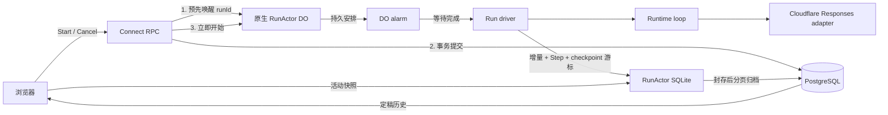

# Heveta 运行架构

本文描述当前实现的领域边界和状态流。应用提供对话入口，经 AI binding 和 AI Gateway 生成回复（请求直接交给 binding，响应用 OpenAI SDK 的流解析器读取）。工具目前有记忆、历史对话检索、网页搜索与读取、每个用户一台电脑（沙箱）上的命令与文件工具，以及电脑屏幕上那个浏览器的操作工具（Playwright MCP，见 [Agent 沙箱](sandbox.md)）；没有图片生成等功能。

2026-09-29：活动输出与恢复状态已迁入 RunActor 的 SQLite，最终历史分页归档 PostgreSQL；按绿地开发移除了旧 PostgreSQL checkpoint 写入入口。概念见 [agent-model.md](agent-model.md)，持久化契约与验证限制见 [run-storage.md](run-storage.md)。已于 2026-09-30 完成生产数据库迁移和 Cloudflare 部署。

## 概念

| 名称           | 含义                                                                                           |
| -------------- | ---------------------------------------------------------------------------------------------- |
| Thread         | 用户保存、命名和浏览的对话容器                                                                 |
| Auth Session   | 一次登录授权，与 Thread 分开                                                                   |
| Turn           | 一次用户输入；它的输入是其用户消息，它的尝试是其 Run，显示最新一次                             |
| Run            | Turn 的一次执行尝试；拥有 attempt 和执行状态                                                   |
| Step           | Run 内一次持久化的执行操作：MODEL（一次模型调用）或 TOOL（一次工具调用）；服务端私有，记录用量 |
| Message        | 产品层输入或回复；用户 Message 属于 Turn，助手 Message 同时属于 Turn 和产生它的 Run            |
| MessagePart    | 产品消息中的文本、附件或协议定义的结构化内容                                                   |
| LoopCheckpoint | 私有模型上下文、待答调用、步骤位置和恢复阶段；边界上的步骤变更另写入 steps；不是公开 Run 快照  |
| Revision       | 一个 Run 公开投影的已提交版本，与 token 块数量无关                                             |

层级是 Thread → Turn → Run → Step，完整契约见 [领域模型](agent-model.md)。重新生成（`RetryTurn`）在同一 Turn 下创建 attempt 加一的 Run；原 Run 和输出保留，不再显示。用户 Message 属于 Turn，Thread 的消息列表按 Turn 展示其输入消息和最新尝试的输出消息。助手 Message 带着产生它的 Run 的状态（`run_status`），所以历史里一条更早的失败或已停止的回复也能看出结果。供应商消息 ID 和内容位置由文本元数据保存，不能与产品 Message ID 混用。

## 代码边界

| 路径                                            | 职责                                                                                                                                                                 |
| ----------------------------------------------- | -------------------------------------------------------------------------------------------------------------------------------------------------------------------- |
| `apps/web/app/features/auth/`                   | 登录实例：记住的账号、向服务端确认当前账号、登录与退出                                                                                                               |
| `apps/web/app/features/threads/`                | Thread UI；`ThreadDrafts` 保存草稿，`ThreadSubmissions` 管理提交，薄 ThreadController 组合 UI 操作                                                                   |
| `apps/web/app/features/runs/`                   | run-state 把 Run 的变化应用到它的回复消息上，run-sync 按 Run 依次把事件通道上的事件应用到对话的消息列表（`threads/queries.ts` 的 `showRun`、`applyRunChangeToList`） |
| `apps/web/app/features/events/`                 | 事件通道：连接、心跳、断线重连                                                                                                                                       |
| `apps/server/src/runtime/loop.ts`               | 模型与工具的循环、用量统计与检查点边界                                                                                                                               |
| `apps/server/src/runtime/tools.ts`              | 工具接口、调用与失败转为结果                                                                                                                                         |
| `apps/server/src/runtime/responses/`            | 经 AI binding 的 Responses 流式请求（SDK 的流解析器）、模型读的文件和输出解析                                                                                        |
| `apps/server/src/runtime/adapters/`             | Thread 消息到运行时输入的转换                                                                                                                                        |
| `apps/server/src/modules/runs/actor.ts`         | RunActor 生命周期、持久唤醒与取消通知                                                                                                                                |
| `apps/server/src/modules/runs/driver.ts`        | 运行调度：驱动 loop、聚合产品输出并提交状态                                                                                                                          |
| `apps/server/src/modules/turns/service.ts`      | StartTurn/RetryTurn 应用服务（空 threadId 时同时创建对话）                                                                                                           |
| `apps/server/src/modules/runs/service.ts`       | Cancel 应用服务、终态发布（`publishRunState`）                                                                                                                       |
| `apps/server/src/modules/runs/delivery.ts`      | 投递和定时补投                                                                                                                                                       |
| `apps/server/src/modules/runs/commands.ts`      | 受理与取消意图事务                                                                                                                                                   |
| `apps/server/src/modules/runs/queries.ts`       | 所有权查询、快照、事件和执行恢复读取                                                                                                                                 |
| `apps/server/src/modules/runs/local-storage.ts` | 活动增量、片段版本、Step、原生上下文与 checkpoint 游标提交                                                                                                           |
| `apps/server/src/modules/runs/records.ts`       | 数据库记录到公开 Run 的转换                                                                                                                                          |
| `apps/server/src/modules/threads/storage.ts`    | 产品消息的 domain JSON 编解码                                                                                                                                        |
| `apps/server/src/modules/threads/part-codec.ts` | 消息片段的 RPC 转换                                                                                                                                                  |

Loop 不引用数据库记录、RPC 生成类型或产品 Message。Responses 适配负责模型格式，driver 的输出投影负责将运行时文本快照和增量转换为产品片段。公开 Run 在 `modules/runs/types.ts` 定义，数据库 `RunRecord`（`db/schema/runs.ts`）另有所有者、幂等指纹和只写日志的 `error` 等内部字段。

## API

协议统一位于 `proto/heveta/v1/`，通过 Connect HTTP 提供八个服务：

| 服务                        | 方法职责                                                                                         |
| --------------------------- | ------------------------------------------------------------------------------------------------ |
| `heveta.v1.AuthService`     | 邮件验证码登录（首次登录创建账号，设置会话 cookie）、查询当前账号、改名、退出登录                |
| `heveta.v1.ModelService`    | ListModels：返回服务端写死的可选模型清单与默认模型                                               |
| `heveta.v1.ThreadService`   | Thread 查询、分页、重命名、删除与消息列表；Thread 由 StartTurn 创建                              |
| `heveta.v1.TurnService`     | StartTurn、RetryTurn                                                                             |
| `heveta.v1.RunService`      | GetRun、CancelRun                                                                                |
| `heveta.v1.FileService`     | 删除文件；上传不经 RPC，走 `POST /upload`                                                        |
| `heveta.v1.MemoryService`   | ListMemories、DeleteMemory、DeleteAllMemories；写入只经模型的记忆工具                            |
| `heveta.v1.ComputerService` | 浏览用户那台电脑的工作区文件、重启/恢复快照/清空工作区（屏幕和终端是会话 cookie 下的 WebSocket） |

`TurnService.StartTurn(thread_id, request_id, input, model_id)` 接受一次新输入，原子创建 Turn、用户消息、第一个 Run 和助手消息，返回 RunSnapshot（开始新对话时还有那个 Thread）。`thread_id` 为空时开始新对话：在同一事务中创建 Thread，标题取输入文字去除首尾空白后的前 40 个字符，没有文字时为空（界面按用户的语言显示“未命名对话”或 “Untitled”）；新 Thread 由响应的 `thread` 返回（它的 ID 也在 `snapshot.run.thread_id`）。没有单独的创建 Thread 接口，因此回包丢失或提交前取消不会留下空 Thread；以相同 requestId 和输入重放返回同一 Thread、Turn 与 Run，空 `thread_id` 属于请求指纹的一部分。首个 Turn 的第一次尝试一开始执行，就在后台用默认模型生成一个更贴切的标题，与回复并行、不等回复结束；生成好时若标题还是这个从输入截取的初始值（没有被改名），就替换它，并通过事件通道推送给用户的所有设备（`modules/threads/title.ts`，`runs/driver.ts` 的 `titleFirstTurn`）；没有文字可用于生成时（纯附件输入），标题保持为空。`TurnService.RetryTurn(turn_id, previous_run_id, request_id, model_id)` 检查 `previous_run_id` 是这个对话最新 Turn 的最新尝试，为同一 Turn 创建下一次 attempt，返回 RunSnapshot；对话显示 attempt 最大的那次，不另存“选中”指针。`model_id` 必须来自 `ListModels`；新输入不传时用默认模型，重试不传时沿用上一次尝试的模型；所选模型不支持图片而输入带图片时拒绝。Run 记录实际使用的模型。相同 requestId 与输入返回同一命令的结果，不重新执行终态 Run；不同输入复用 requestId 被拒绝。

`RunService.GetRun` 按 `run_id` 读取，`CancelRun` 的 lookup 是 `run_id` 或 `request_id` 的 oneof（还不知道 Run 的发送按 requestId 停止），均返回 `RunSnapshot`。服务端还没受理时按 requestId 停止，就是撤回这次发送：在同一把请求锁下记下撤回（`withdrawn_requests`，保留一天），答复 NOT_FOUND 加 `REQUEST_WITHDRAWN`，之后这个 requestId 的任何副本都被拒绝；已受理时则照常停止它的回复。所以结果未知的发送，停止后一定有确定的结局。

所有 RPC 都是一问一答。进度和其他变化在提交后通过按用户的事件通道（WebSocket）推给该用户的所有设备，设计见 [多端同步](sync.md)。Run 事件是快照或下一个 revision 的变化；设备发现 revision 断档时用 GetRun 重取快照，断线重连后重新读取页面上的数据，事件不重放。公共接口不直接暴露 RunActor 的内部方法。

## 受理与后台执行

受理事务锁定 requestId 和 Thread，检查所有权及活动 Run、锁定并引用附件、写入输入/输出消息与 QUEUED Run。数据库唯一约束限制每个 Thread 同时最多一个 QUEUED 或 RUNNING Run。删除 Thread 时，正在生成的回复随之停止：它的 Run 随对话一起删除，actor 在提交后被通知，下一次提交发现 Run 不在了就干净地退出。

生命周期时间明确分开：`createdAt` 是受理时间；`startedAt` 直到 actor 首次领取才设置；`finishedAt` 只在终态设置。Run 没有排队期限：已提交的 Run 必定由事先安排好的 actor 领取。

PostgreSQL 和 actor 不能同在一个事务里，所以顺序决定了会不会出现“已提交却没人执行”的 Run：受理前先生成新 Run 的 ID，让它的 actor 安排一个 60 秒后的 alarm（`armRun`），再开受理事务，事务用 `transaction_timeout` 限制在 30 秒内（需要 PostgreSQL 17 及以上）；提交后照常让 actor 立即开始（`dispatchRun`，把 alarm 提前到现在）。提交后的这次通知丢了，预先安排的 alarm 到时会找到已提交的 Run 并执行；事务没有提交（被拒绝、失败或超时），alarm 到时查不到 Run，直接退役。预先唤醒失败时不受理，返回 `Unavailable`，客户端稍后用同一个 requestId 重发。所以没有扫描数据库的定时任务。停止也不依赖它：`CancelRun` 记下取消意图后直接通知 actor 中止正在进行的执行，通知不到就返回 `Unavailable`；排队中的 Run 被领取时看到取消标记就直接结束。一个 Run 对应一个项目自定义的 `RunActor`，直接继承 `cloudflare:workers` 的 `DurableObject<Env>`，不依赖 Agents SDK。

`ensure` 在存储事务中保存 runId、持久安排 alarm 后返回，不等待模型调用；已有执行时不另开 alarm。Run 在 DO 的后台执行，不在 alarm 处理器里：处理器一次最多运行 15 分钟，而 Run 没有时长上限。alarm 触发时先把下一次唤醒排在 30 秒后，再在后台开始 `executeRun` 并返回；执行期间这个 alarm 就是心跳，每 30 秒一次，让 DO 不因 70–140 秒没有事件而被驱逐（和 Cloudflare Agents SDK 的 `keepAlive` 相同的做法）。心跳到来时内存中有执行就只续排下一次；没有（实例重启过，例如部署）就从本地 SQLite 保存的边界恢复。执行结束时它自己决定唤醒：结束就撤掉，失败就按退避重排。同一实例用内存中的执行 Promise 防止重复启动，用对应的 AbortController 接收即时取消。DO 的 `run-schedule` 记录只保存 runId 和连续失败次数，唤醒时间由原生 alarm 保存；SQLite 持有活动 Run 的输出、revision、Step 和原生工作窗口；PostgreSQL 持有受理、控制意图、文件引用和最终归档。

心跳让执行器在实例重启后重新进入，但不保证同一进程一直存活。唤醒可能重复，执行器先核对 PostgreSQL 的存在性、终态和取消意图，再完成本地已暂存批次、封存归档或 Checkpoint 恢复：终态不再执行，活动状态按下文的恢复阶段处理。异常重试针对恢复入口，不直接重试模型请求。模型请求不经 OpenAI SDK 的客户端发送（请求对象直接交给 binding，避免带着文件数据的请求体被序列化、解析、再序列化），所以没有 SDK 自带的快速重试；服务商在生成任何内容之前拒绝、且稍后可能接受的请求（408/409/429/5xx，或 `x-should-retry: true`，与 SDK 重试的范围相同；请求根本没有得到回答时也算）由 loop 把 MODEL Step 记为失败、检查点退回 `ready`，交给 actor 退避后重新发出。流一旦开始就不再重发；最坏情况是一次重复计费，不会重复任何动作。

提交分为流进度与操作边界。流进度每 250 ms 聚合；累计 100 次更新或 64 KiB 待写文本时施加背压。每批使用稳定 ID 与内容摘要，正文追加到有大小上限的 SQLite 行；先确认暂存可靠，再在短事务中推进片段版本、Step、原生项和 checkpoint 的可见位置，按需分配一个公开 revision。重试同一批不追加正文或重复版本，通知丢失可以重新发布相同 revision。

操作边界提交成功后才进入下一操作。通常重试 3 次，完整模型／工具结果或结束封存重试 8 次；失败后由 actor 退避恢复，首先完成已经可靠暂存的结果和文件引用登记。原生工作窗口只追加新项，窗口滑动／结果或文件清理时重建 epoch，可靠切换指针后清理旧基底。

模型给出最终回复、取消或失败时先封存输出与候选终态。封存后不再执行模型或工具，也不分配新进度 revision；预留下一个终态 revision。actor 按分页摘要与游标将最终片段、正文块和 Step 导入 PostgreSQL，最终事务核对交接身份及完整性、收尾 Step、构建会话检索文本、释放私有文件引用、发布终态。只有该事务完成，同一 Thread 才能受理下一 Run。归档／终态通知失败继续退避，不把已经取得的结果改成执行失败。

连续 5 次执行没有操作结果进展，下一次唤醒封存为失败或已停止。执行开始就持久记录次数，已保存操作结果重置计数；实例在执行中消失也算一次。心跳每 30 秒观察 PG 控制记录，发现取消或删除就中止当前执行。归档与通知重试始终保留封存结果；PG 已终态时只补通知，确认终态或删除后才清除本地正文和 alarm。

浏览器请求的 AbortSignal 不属于已受理 Run；刷新、关闭或切换对话只结束观察。CancelRun 先在 PG 保存取消意图，再通知 actor；actor 观察到新取消意图时更新自己的公开 revision。通知失败返回 Unavailable，再次请求再次通知。操作边界和心跳也会观察控制意图。取消不是终态；最终 PG 事务裁决完成与取消的竞争，模型已经完整完成时仍为 COMPLETED。

新对话首轮的标题在执行开始时后台生成，回复从不等它：标题写好后作为 thread 事件单独送达设备。

## 快照、变化与 Revision

`RunSnapshot` 包含公开 Run、输入 Message、输出 Message 和 revision。`RunEvent` 只有两种内容：

- `snapshot`：替换本地完整投影，允许与当前 revision 相同。
- `change`（`RunChange`）：一次提交的变化，带自己的 revision、完整公开 Run、输出片段的 upsert/文本 delta（part changes）和输出更新时间。

活动公开变化由 DO 单独分配 revision；Step 和私有 checkpoint 变化本身不增加公开版本。正文的不可变块及带 commitSeq 的版本头，让多次内部 RPC 读取同一个提交位置。PG 取消意图不分配公开 revision，最终归档使用 DO 预留的终态 revision。

GetRun、重复 Start／Retry 与消息列表先在 PG 鉴权，活动输出按 DO 的固定提交位置分页读取，再复查 PG 的存在性与归档状态；已经归档则读取 PG，已经删除则返回 NotFound。读取期间不持 PG Run 行锁等待 DO。长工具结果的摘要在读正文前就省略，详情仅加载指定结果。历史上下文重建先按片段元数据与原始正文长度决定窗口，再加载保留的正文。

浏览器对快照整体替换，对变化仅按连续 revision 应用。重复或较旧 revision 不再次追加文本；缺口需要新快照。Get/Start/Cancel 与事件通道使用相同缓存版本规则，避免迟到响应覆盖新进度。断线不会自行把 Run 改成失败。

## Loop 与恢复边界

loop 是一个不设预算的循环：调用模型；模型请求了工具就执行，把结果交回模型，再调用模型；模型不再调用工具时 Run 以 `MODEL_COMPLETE` 结束。没有步数、token 或时长上限，只有用户停止（`CANCELLED`）或错误（`ERROR`）能提前结束；`ERROR` 时 Run 的 `error` 字段只在异常是面向用户的 `AppError`（且不是 `Internal`）时原样给出它的消息，其余情况一律是通用文案，内部细节不泄露给用户。请求不传 `max_output_tokens`，按模型自身上限；回复被模型自身上限截断时保留已生成文字并正常结束，但截断发生在工具调用参数中则失败，不执行不完整的调用。供应商 message/content 边界、phase、status 和 refusal 先在适配器中解释，再投影为产品消息；模型返回未提供的能力会失败。

工具由 `src/modules/runs/tools.ts` 按 Run 的用户组装，当前有网页搜索与读取（`src/modules/web/`，TinyFish 优先、失败时 Jina 接手，工具名 `web_search`、`web_fetch`）、记忆工具（`src/modules/memories/`）和对话检索工具（`src/modules/threads/tools.ts`，工具名 `conversation_search`、`conversation_read`，按关键词搜本用户的对话（含当前对话，滑出窗口的内容从这里找回）、按 id 从指定条目分段读）。每次请求在系统指令之后、对话记录之前附上最近更新的 100 条记忆（带 id），作为 user 角色里引用的数据而不是指令（设计见 [agent-design.md](agent-design.md) 第 4 节）；更早的条目由模型用 `memory_search` 按关键词查。Loop 只拿到工具声明（`ToolSpec`）和一个执行器（`ToolExecutor`），调用交给执行器执行；一个 Run 的工具由 `composeToolSets`（`modules/runs/tools.ts`）按工具名分给多个执行器：网页、记忆、对话检索这些在本地执行器（`localToolSet`）里，和 loop 跑在同一个 Worker；选了电脑的 Run 另加电脑的沙箱执行器和浏览器执行器（命令、文件工具与 Playwright MCP，见 [sandbox.md](sandbox.md)）。设计见 [tool-execution.md](tool-execution.md)。每个工具声明是否只读：同一步请求里，相邻的只读调用一起开始；会改变什么的调用要等它前面这些调用完成，它后面的调用也要等它完成。工具失败（工具不存在、参数不是 JSON、执行出错）都作为 `is_error` 结果交给模型，由它换一种做法，不终止 Run；内部错误细节不进入对话，只有 `AppError` 的消息会原样给出。结果里的 NUL 字符（`\u0000`，命令输出或读到的文件可能有）换成 U+FFFD 再存：PostgreSQL 的 text/jsonb 不能存 NUL。

每次模型调用和工具调用各是一个 Step，index 在 Run 内连续递增。工具请求先登记为 PENDING（createdAt，startedAt=null）；外部调用前可靠提交 RUNNING 和 startedAt，取得结果后保存 COMPLETED 或 FAILED。恢复沿用同一 Step ID 与 index；只对已经 started 的有副作用调用尝试收集结果，无法收集时记录未知，不重发。尚未 started 的调用正常首次执行；只读调用可以重新执行。

服务端片段元数据保存 stepIndex，公开协议沿用文字的供应商位置和工具 callId。reasoning Part 是公开摘要，仅原生工作窗口保存加密推理；后续 Run 不读取先前的加密推理。终态收尾将未发出的 PENDING 记为 CANCELLED，RUNNING 按取消／未知模型结果／失败原因收尾。已完成的步骤不改写，未知 token 用量保持 null。

LoopCheckpoint 保存原生模型上下文、恢复位置和 token／字符估算比例；已知 token 用量单独记在 Step 上。窗口的 `omitted.contextSegments` 统计被移出的上下文段，一段可含多个 Step，与执行步骤计数分开。恢复规则如下：

| 阶段            | 恢复行为                                                                                                                                                                                                                                                                                                         |
| --------------- | ---------------------------------------------------------------------------------------------------------------------------------------------------------------------------------------------------------------------------------------------------------------------------------------------------------------- |
| 尚无 Checkpoint | 从已保存输入准备上下文                                                                                                                                                                                                                                                                                           |
| `ready`         | 从保存的安全边界继续下一次模型调用                                                                                                                                                                                                                                                                               |
| `model`         | 模型请求结果未知；失败并保留已提交的部分输出，不重复调用。服务商在生成前暂时拒绝的请求不会留在这个阶段：loop 已把它的 Step 记为失败、退回 `ready`                                                                                                                                                                |
| `tools`         | 重新发布待答调用。它们按模型给出的顺序执行：相邻的只读调用一起开始，会改变什么的调用等它前面的完成、它后面的等它完成。一次恢复里只有第一个待答调用可能已经开始过：只读的直接重跑；会改变什么的，执行器能收集到结果（`resume`）就用那个结果，收集不到就告诉模型结果未知，不重复执行。其余待答调用都按全新调用执行 |

模型调用前先提交 `model`，外部结果与产品投影在操作边界一起提交。数据库中已提交的进度可重新读取，但未提交的流增量不在恢复保证内。这里不承诺重连供应商原来的 token 流。

**执行。** 一次执行在 DO 后台一直跑到 Run 结束，没有时间分段：模型请求和命令需要多久就等多久（命令只受它自己的超时限制）。只有实例重启（部署、平台调度）会打断一次执行，下一次心跳从最后保存的边界继续；打断时正在跑的命令继续在电脑里跑，下一次执行用执行器的 `resume` 去收集它的结果；用户主动停止则直接杀掉这个进程。

Run 没有总时长上限，只受连续失败次数限制。模型请求前的瞬时错误（数据库、R2）由 actor 退避重试；连续 5 次执行都失败（`maxConsecutiveFailures`）且没有提交任何新边界时，actor 结束 Run，只要有一次执行有进展就重新计数。计算 token 用量的字符比例（`tokensPerChar`）只用没有发送图片或 PDF 的请求重新校准，避免文件的 token 抬高每字符的估算；校准之前（包括从第一轮就带着文件的对话）用实测得出的默认值 0.25（见 [agent-design.md](agent-design.md) 第 3 节）。

## 浏览器状态归属

Thread 草稿按 userId、登录实例版本和 threadId 保存。提交所有者持有 requestId、输入快照和状态（发送中、被拒绝可重试）；消息一发出就离开输入框，服务端拒绝才放回。结果未知的提交用同一个 requestId 重发，服务端同一个请求只受理一次，不会重复创建消息。重新生成不清空正在编辑的下一条草稿。

事件通道在登录后打开，按 Run 依次应用进度；观察者跟踪每个对话最新的 Run。Start 的迟到确认只更新其原 Thread；切换页面不会将它附着到新 Thread。停止早于 Start 确认时保存取消意图，取得 runId 后继续完成取消。退出登录使原登录实例的请求和回包失效，清理内存草稿并关闭事件通道。

浏览器草稿不跨页面刷新持久化。服务器保存已接受提交、运行状态和消息。登录会话独立于 Run 执行；网络错误不退出登录，只有服务端说会话已结束或属于别的账号时才跟着改变。

## 数据与附件

Thread 消息以 domain JSON 保存，片段中的文件大小编码为十进制字符串；RPC 转换使用独立 codec，不把 protobuf JSON 当数据库格式。输出 Message 汇总一次 Run 的产品内容，文本元数据仍可区分不同供应商 assistant 消息。

图片和 PDF 只通过所属用户的文件记录和 R2 storageKey 读取。文件的状态是明确的：`uploading`（对象在写入）、`stored`、`deleting`（谁也不能再用，清理删掉对象和记录）。哪些消息引用了哪些文件记在 `message_files` 里（附件、回复发出的文件、工具结果里的图），被引用的文件不能删除。发送消息和提交回复时，在同一事务里锁定这些文件并记下引用：只有已存好、并且已被引用或 24 小时内上传的文件可以被引用，更旧的无人引用的文件是垃圾，清理可能正在删它，所以发送和清理从不冲突。每小时第 17 分钟的清理删除标记为 `deleting` 的，以及上传满一天仍无人引用的文件。删除对话时，只被它引用的文件在同一事务里标记为 `deleting`：`/files/<uuid>` 直接从 R2 读取，不能等到一天之后。

历史输入是滑动窗口（`runtime/window.ts`，设计见 [agent-design.md](agent-design.md) 第 3 节）：每轮开始按 Thread 的 `context_window`（窗口起始的 Turn、清理工具结果的边界、清理文件的边界、实测的 token/字符比例）从数据库重建，每次模型请求前检查，用到工作窗口 80% 时清理旧工具结果并整段滑出最早的内容，降到 20%；滑出的单位是一条用户消息连同对它的完整回复（`runtime/window.ts` 的 units），不拆散问答；只有当前这一轮自己最近的 3 次工具结果受保护。滑出的轮数和其中的用户原话以窗口开头的 developer 消息告诉模型。请求的组成：固定的系统指令与工具定义；记忆列表（user 角色，一次执行内不变，在缓存的前缀里）；窗口内的历史与本次 Run 的 items（只往后追加）；最后是邮箱地址、当前日期和回复格式要求（公式只用 `$…$` 与 `$$…$$`，网页的 Markdown 只排版这两种；这条放在系统指令里时模型在低推理强度下不遵守，放在末尾才遵守）。请求带 `prompt_cache_key`（对话 id）。模型自己读的文件（图片、PDF）合计预算 20 MiB（`agentConfig.limits.modelFileBytes`，按文件记录的大小计算），达到 80% 时从最旧的开始换成说明文字，降到 20%（当前输入的附件和模型还没看过的工具结果除外）；这些文件不当作对话文本，其余类型的附件从不进模型的请求，只放在电脑上（见 [Agent 沙箱](sandbox.md)）。模型上下文与 Checkpoint 中的图片和 PDF 只是文件引用（`heveta-file:<fileId>`）；loop 在提交 `model` Checkpoint 前才从 R2 读取并构造本次请求的 data URL（图片放进 `image_url`，PDF 放进 `file_data`），文件数据不进入历史副本或 Checkpoint。早先消息的图片已不可读时替换为占位文字，当前输入的图片必须可读；Run 的模型不支持图片时，早先消息的图片同样替换为占位文字。私有模型上下文可能含加密推理项，只进入 Checkpoint，不进入公开 Run 或事件；模型侧 `store: false` 不等于应用没有执行存储。

## 数据库与部署

代码导出三个原生 DO 类：`RunActor`、`UserHub` 和 `Computer`，通过 `ctx.exports` 调用。`Computer` 使用原生容器和 30 天文件系统快照，句柄保存在自己的 SQLite DO 存储；不再导出 R2 目录备份 Gateway。项目不依赖 Agents SDK。[Cloudflare Durable Object exports](https://developers.cloudflare.com/durable-objects/reference/durable-objects-migrations/)

迁移位于 `apps/server/drizzle/migrations/`，都由 drizzle-kit 根据 `src/db/schema/` 生成。所有关系都是子表指向父表的外键，没有父表指回子表的循环引用，因此不需要可延迟约束或手写 SQL（`derived_state_removed` 迁移开头删掉了基线里手写的那三个循环外键）。生成的迁移只为数据回填和生成器表达不了的前提手工补充：`conversation_text` 回填 `messages.text`、把已存的工具参数对象转成文字，并在 trigram 索引之前 `CREATE EXTENSION IF NOT EXISTS pg_trgm`（部署前需确认生产库允许迁移角色创建这个扩展）。部分索引（`runs_active_thread_idx`、`messages_turn_input_unique`）的条件在查询里写成字面量（`unfinishedRun`、`userMessage`），不作为参数绑定：通用计划（缓存的预编译语句）无法从参数证明部分索引的条件，会改用别的索引或全表扫描（本地在 `plan_cache_mode = force_generic_plan` 下用 EXPLAIN 核对过）。`threads.user_id` 与 `files.user_id` 均引用 `users`。

部署时为目标数据库设置 `DATABASE_URL`，运行 `mise run db:migrate`；再运行 `pnpm run deploy` 或 `mise run deploy` 一起发布前后端。部署命令不会代为迁移 PostgreSQL。本地开发用 `pnpm db:setup` 迁移本地 Docker PostgreSQL。

`mise run check`、`mise run test:integration`、`pnpm build` 是自行验证的入口。
